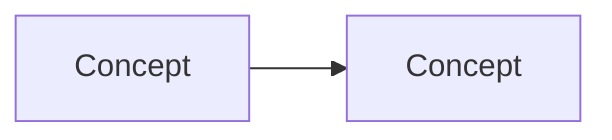

# Feature Specification

## Metadata

Feature:
Issue:
Status: READY | NEEDS CLARIFICATION | BLOCKED
Revision: r<N> (supersedes r<N-1>; history in Changelog)
Scope baseline: <Clarification Record comment id> | N/A — <reason>
Code read: <repo> `<sha>`, … | N/A

## Requester Summary

<Vietnamese, at most 10 lines, no IDs-only jargon. A reader who stops here
knows what will be built.>

- Làm gì: …
- Không làm: …
- Ảnh hưởng: App / Server / DB / Web Admin / … (only the ones touched)
- Độ lớn: S | M | L | XL — ~N FR, N repo, ~N workstream (vs baseline: = | +x%)
- Cần bạn quyết: <Q-xxx in one line each> | Không có

## Glossary

N/A — <reason> when every term is plain language.

| Term | Meaning in this spec |
|---|---|
| … | … |

## Summary and Goal

<2–4 sentences: problem, goal, who benefits.>

## Scope

- In scope: … (each item tagged `[REQ]`, `[DER]` or accepted `[PROP]`)
- Non-goals / out of scope: …

## Current vs Desired Behavior

- Current: <short statements; cite evidence as E-001, details in Appendix A, or `UNKNOWN`>
- Desired: …

## Diagrams

N/A — <reason> when there is no domain model or multi-step flow.

At most two Mermaid diagrams, conceptual only (no tables, columns or classes):
a domain concept map and/or the main flow.



## Flows

N/A — <reason> when there is no user- or system-visible flow (e.g. internal refactor).

- Main: 1. … 2. …
- AF-001 (alternative): …
- EF-001 (error): …

## Screens and States

N/A — <reason> when there is no user-visible UI change.

| Screen / surface | States the user can see | What the user sees and can do |
|---|---|---|
| … | loading · empty · ready · error · offline · stale | … |

## Requirements

Format: `- <ID> [Must|Should|Could] [REQ|DER|PROP]: <requirement>`.
A requirement that depends on an unconfirmed option carries `[Q-xxx★]`.

- FR-001 [Must] [REQ]: …
- BR-001 [Must] [DER]: …
- NFR-001 [Should] [REQ]: …

## Edge Cases

- EC-001: …

## Invariants

N/A — <reason> when the change mutates no persisted or shared state.

| ID | Must always hold (business terms) | Covers | Threats to consider |
|---|---|---|---|
| INV-001 | A lesson completion is recorded at most once per learner and lesson | FR-001, BR-002 | double submit, retry, offline replay |

## Acceptance Criteria

One scenario per line. Surface tags: [App] [Server] [DB] [Web Admin] [Migration] [Cleanup].

### AC-001 (covers FR-001, EC-001)

- S1 [App]: Given … When … Then …
- S2 [Server] [DB]: Given … When … Then …

## Assumptions and Open Questions

| ID | Assumption or question | Options (★ = smallest that meets the goal) and cost | Impact | Blocking |
|---|---|---|---|---|
| A-001 | … | — | … | NO |
| Q-001 | … | ★A. … (cost) · B. … (cost) | … | YES/NO |

## Dependencies, Constraints and Risks

- Dependencies: …
- Constraints: …
- R-001: <risk> — Impact LOW/MEDIUM/HIGH — Mitigation: …

## Readiness

Status: READY | NEEDS CLARIFICATION | BLOCKED
Reason: …

## Changelog

N/A — first revision.

- r<N>: <what changed and why, with the decision or finding ID>
- Retired IDs (never reused): …
- Moved to other issues: <IDs> → <ISSUE-KEY>

## Appendix A — Evidence

N/A — no code or document evidence was needed.

| ID | Claim | Source (`S:`/`A:` path:line, doc, comment id) | Label |
|---|---|---|---|
| E-001 | … | … | VERIFIED / INFERRED |

### Implementation pointers

N/A — <not Workflow v2 MEDIUM | LARGE: the design owns this>.
Pointers only; not requirements.

| Work area (E-xxx) | Likely change | Existing tests to extend | Suggested block order |
|---|---|---|---|
| … | … | … | 1 |

## Workflow Handoff

```yaml
<workflow-state-protocol handoff>
```
